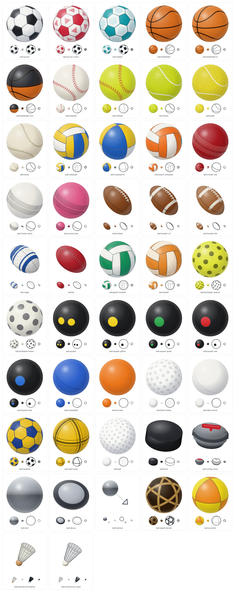
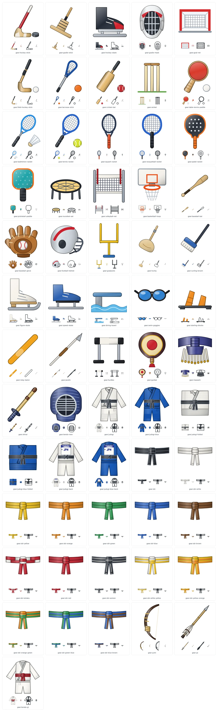

# Emblems: how the art is drawn

[Back to the README](../README.md). Every emblem has an **id** (`trophy:hockey-cup`, `medal:gold`, `crest:shield`, `sport:nhl`, `ball:rugby`, `gear:hurley`), a name in English and in Japanese, and three styles. [gallery.md](gallery.md) lists them all with their names, kind, source and the import that takes each alone; the [gallery page](https://johnmorrisdotca.github.io/dougu-sports/gallery.html) draws them, with a button that copies each id.

```js
import { renderEmblem } from "@johnmorrisdotca/dougu-sports/emblems";

const metal = renderEmblem("trophy:hockey-cup");
const line = renderEmblem("trophy:hockey-cup", { style: "line", size: 16 });
const same = renderEmblem("trophy:hockey-cup/line", { size: 16 });
console.log(metal.includes("linearGradient"), line.includes("linearGradient"), line === same);
// true false true
```

## The three styles

- **`metal`** (the default) is polished metal, drawn the way modern icon sets are: clean shapes, no heavy black outline. Each round part has its own shading, a dark edge, a bright band left of the middle, the metal, a darker side and a faint light from the rim; a narrow highlight runs down it; a step or a ledge shows its top as a lighter ring; and the edge of a part is a darker tone of the metal, so the drawing holds on a white page and on a dark one.
- **`line`** is one clean outline in `currentColor`, with the small details left out, so that it takes the page's text colour and reads at 14 pixels. `"trophy:hockey-cup/line"` is the same as `{ style: "line" }`; the option wins if both are given.
- **`color`** is flat fills of the same tones, with no gradient.

The other options are `size`, `tint` (the main colour: the metal of a trophy, a crest's colour), `accent` (a second colour: a ribbon, a band, the pennants), `initials` (a crest's letters) and `theme`. `renderEmblem` is pure: the same call gives the same string.

## The trophies

A trophy is a body of revolution (kind `lathe`): a profile, which says the radius at each height, with what stands on it. One model draws the still emblem and the turned one. The profile is cut into pieces at its corners and its steps, and each piece is shaded across its own width, so a stack of bands widening one below another reads as a stack. The things that stand on the profile are:

| Part | What it is | Used by |
| --- | --- | --- |
| handles | A tube through points in the plane of its angle, drawn behind the cup when it is turned to the far side | the bowl, the cups, the urn |
| balls | A sphere with its seams (a basketball's, a soccer ball's, a globe's lines, a baseball's stitches), a football leaning at an angle, a pineapple | the ball trophies, the globe, the tennis cup |
| poles | A ring of poles, each with a pennant, their tops stepping up once round | the baseball trophy |
| decor | Rings, meridians, spiral strands, a net of diamonds, beads, and on a dish rings of gilt and rounded panels | the globe, the basketball, the plate |
| flat faces | A body of three or more flat sides, each lit by which way it faces | the football's stand |

Ten of them stand for the cup of a league or a sport, in a generic form that a reader knows at a glance. None carries a name, a mark or an engraving, and none is traced from a photograph:

| Id | What is drawn |
| --- | --- |
| `trophy:hockey-cup` | A tall silver cup: a small flared bowl, a collar, a bell, and a barrel of five bands that each widen a little, on a dark foot |
| `trophy:baseball` | A ring of thirty gold pennants on poles, their tops stepping up once round, standing round a silver baseball on a round base |
| `trophy:football` | A silver football leaning on one end, as if ready for a kick, on a tapered three-sided stand with a stepped base |
| `trophy:basketball` | A gold ball resting over a rim and a net, on a tapered column and a stepped base |
| `trophy:canadian-bowl` | A wide silver bowl with two handles on a stem, over a tall conical base of panels with a dark band and foot |
| `trophy:soccer-globe` | A gold globe held up by figures that spiral round a column flaring from a slim waist, over two green bands |
| `trophy:tennis-plate` | A silver salver on a pedestal, with rings of gilt and rounded panels on its face |
| `trophy:tennis-cup` | A gilded two-handled cup with a domed lid and a small pineapple, on a stem and a plinth |
| `trophy:cricket-urn` | A small terracotta urn with square handles, on a wooden base |
| `trophy:rugby-cup` | A gilded two-handled cup with a lid and a tall finial |

The rest are the plain `trophy:lidded-cup`, `trophy:bowl`, `trophy:salver`, `trophy:globe` and `trophy:soccer-ball`, the plain two-handled cup `trophy:cup`, and the flat `trophy:plaque`, `trophy:belt`, `trophy:laurel` and `trophy:rosette`. The two Japanese ones, `trophy:sumo-cup` and `trophy:championship-banner`, are in [japanese-sports.md](japanese-sports.md).

## Medals, crests and pictograms

- **Medals** (`medal:gold`, `medal:silver`, `medal:bronze`) are a disc lit like a round of metal, with a bevelled rim, a star in relief and a plain back, hung from a ribbon of five stripes (blue, yellow, black, green, red); no rings are drawn. A medal flips like a coin. The `medal:place-1` to `medal:place-3` badges are the same disc with a numeral.
- **Crests** (`crest:shield`, `roundel`, `diamond`, `pennant`) are tinted by a team's colour, with a band and a bevelled edge, and the team's letters in the ink that reads on the colour (4.5 to 1, whatever the colour) or a star when it has none. `crest({ shape, colors, initials })` draws one.

```js
import { crest, medal, sportIcon } from "@johnmorrisdotca/dougu-sports/emblems";

const shield = crest({ shape: "shield", colors: ["#bc002d", "#ffffff"], initials: "JPN" });
const gold = medal("gold");
const stick = sportIcon("nhl", { style: "line", size: 20 });
console.log(shield.includes(">JPN<"), gold.includes("<title>Gold medal</title>"), stick.includes("<title>Ice hockey</title>"));
// true true true
```

- **Pictograms** (`sport:*`) are one for each of the thirty-eight sports, all drawn here, each as the equipment (a stone, a shuttlecock, a racket, a net, a stick, an oval ball, and for the Japanese sports a war fan, a helmet, a suit, a bow, a fist). They are drawn in the page's ink, and the metal style gives them a grey sheet when they are tinted.
- **Awards** (`award:*`) are a medal on a ribbon, a badge, a crown, a star and a shield, drawn here and painted with the metal gradient, a bevel and an edge of the metal's own darker tone in the metal style, in flat fills in `color` and as one outline in `line`.

## Balls and gear

`ball:*` (116 balls and implements), `puck:*` (8 printed pucks, [pucks.md](pucks.md)) and `gear:*` (70 pieces of equipment) come from their own engines, described in [src/emblems/README.md](../src/emblems/README.md): a ball is drawn in true 3D (a rotation, a projection, panels cut at the limb, shading and a grain that stays where it is while the ball turns), and carries the official size of the rulebook it is from, which `lineup` draws at (a puck beside a basketball looks right). Gear is a flat drawing in layers, all of it drawn here: in `metal` each part is edged in a darker tone of itself and shaded across and along, in `color` the fills are flat, and in `line` it is one outline in the page's ink. A piece of gear flips like a coin when it is turned. A prolate ball (a football, a rugby ball) is drawn to a point at its ends.





```js
import { emblemInfo, lineup } from "@johnmorrisdotca/dougu-sports/emblems";

console.log(emblemInfo("ball:puck").size.diameterMm); // 76
console.log(lineup(["ball:golf", "ball:tennis", "ball:soccer"], { height: 80 }).includes("<title>")); // true
```

## Engraving

Text cut into a face is an option of any emblem that has a face for it: `engrave` (one string, up to three lines of 24 letters), or `label`, `year` and `rank`. Each such emblem names its plates in its model (`engrave: { front, year, back }`), and a body of revolution its plinth (`plate`).

| Emblem | Where the text goes | What it replaces |
| --- | --- | --- |
| `medal:gold`, `silver`, `bronze` | The face, inside the bevel; `engraveBack` on the back | The star |
| `medal:place-1` to `place-3` | The face (the badge's own place is the first line when a `label` or a `year` is given); `engraveBack` on the back | The drawn numeral |
| `trophy:plaque` | The words on the plate, the year on the nameplate | The ruled lines |
| `trophy:belt` | The centre plate | The star |
| `trophy:ring` | The label up the left shoulder of the head, the year down the right; `engraveBack` on the back of the head | |
| `trophy:banner` | The words on the face, the year under them; `engraveBack` on the back | |
| `pennant:championship` | The felt, from the dowel toward the point | |
| Each of the 16 cups and stands that are bodies of revolution (`trophy:cup` is a flat icon and has none) | One line round the plinth, a letter at a time | |

The lines are fitted to the plate: each is as large as the plate's width lets it be, the stack of lines as tall as its height lets it be, and a free line with a space may be broken in two when that gives bigger letters. Widths are estimated per character (a Japanese character is a full em), and `textLength` pins the width so that the line fits whatever font draws it. The ink is the one of black, white, or a deep or pale tone of the metal that reads at 4.5 to 1 on it (the same rule as a crest's letters); in the line style it is the page's ink. In the metal style a faint light is cut under each line. Text is escaped, control characters are dropped, and a line is 24 letters at most.

On a plinth each letter is placed at its angle round the body (`deg = turn + position`), at the height the body is wide there, scaled by the cosine of its angle, and left out when it faces away; on a body with flat sides the text runs along one side and is foreshortened with it.

## Pennant, ring and banner

`pennant:championship` is a long triangle of felt on a dowel: a speckle of fibres under a soft light in the metal style, flat in colour, an outline in line, always stitched round the edge with a dashed line, and lettered with its words and its year. `pennant(options)` takes the colours (felt, stitching, lettering), the `text`, the `year` and the `view`. Its back is plain felt with the dowel on the other side. `trophy:ring` is a championship ring seen face on (a band, a wide faceted head and a gem in a bezel, the metal the tint and the gem the accent) and `trophy:banner` a rafter banner hung from a rod (the tint is the cloth, the accent its stripes); both are generic and flip as flat items.

## Every emblem turns

Everything that is not a ball or a body of revolution is a flat thing, and turns like a coin (`src/emblems/emblem.flip.ts`): a medal, a crest or a ring from its own front and back, and an icon or a piece of gear (a bat, a racket, a crown, a sport's pictogram) by squeezing its finished drawing by the cosine of the yaw, showing it mirrored and a little darker past a quarter turn, and adding a rim as a filter: the drawing's silhouette in a dark tone, offset a few steps toward the side that turns away. The rim is widest edge on, and in the line style it is the page's ink.

## Light and dark

`theme` says where the ink comes from: `inherit` (the default) is the page's text colour, which is right for markup put in a page; `auto` is dark ink on a light device and pale ink on a dark one, for an image that cannot inherit; `light` and `dark` force one. The metals are the same on both pages. The tests hold every ink to 4.5 to 1 on its page, and the letters of a crest to 4.5 to 1 on the crest's colour.

## Where the art comes from

Every emblem is drawn for this package, and nothing is copied from another project. Earlier versions used sixteen Material Symbols icons and some gear from Noto Emoji, Wikimedia Commons and game-icons.net; all of it has been redrawn, and the third-party art, the scripts that fetched it and its licence files are gone. [NOTICE.md](../NOTICE.md) says so, and [references.md](references.md) says what the sizes and the looks were read from.
