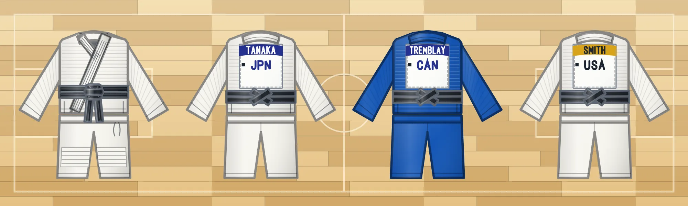

# The judogi from behind, with its back number

[Back to the README](../README.md) · [日本語](judogi-back.ja.md) · English

<picture>
<source media="(prefers-color-scheme: dark)" srcset="images/judogi-dark.webp">

</picture>

At the competitions of the International Judo Federation every judoka wears an official back number sewn on the back of the jacket, made by the IJF's own supplier to a layout the rules fix. `gear:judogi-back` (the white suit) and `gear:judogi-blue-back` (the blue one) draw the suit laid flat and seen from behind, with that patch on it. The sleeves come down to the wrist, as every judogi's do (see [the judo suit](japanese-sports.md#the-judo-suit)).

The patch is the large one, 38 cm wide by 39 cm high, with its top 3 cm under the collar, and on it, from the top down:

- **The family name**, in white capitals on a coloured band across the top. The band is blue; it is gold for an Olympic champion and red for a world champion, for as long as the title is held.
- **The country code**, the three letters of the National Olympic Committee, in bold capitals under the band.
- **The rest of the patch is blank**: at an IJF event the competition's publicity goes there, and this package draws no sponsor's mark.
- A small square at the left edge stands for the label that makes the back number authentic, and the patch is stitched round its edge, shown as a dashed line.

There is no flag on the real patch, so there is none here, and nothing of the IJF's, of the maker's or of a sponsor's is drawn. Where each figure comes from, and what could not be confirmed, is in the [references](references.md#the-ijf-back-number).

## The `backnumber` option

```js
import { renderEmblem } from "@johnmorrisdotca/dougu-sports/emblems";

const svg = renderEmblem("gear:judogi-blue-back", { backnumber: { name: "TREMBLAY", code: "CAN" }, size: 256 });
console.log(svg.includes("<title>Blue judo suit, back view, TREMBLAY CAN</title>")); // true
```

| Field | What it does |
| --- | --- |
| `name` | The family name, in capitals: letters, digits, spaces, hyphens and apostrophes, 16 characters at most. A lower-case letter is its capital and an accented one its plain letter (the rule allows a mark on a letter, as in Müller). A long name is set smaller to fit the band. Without it the patch reads `TANAKA` |
| `code` | The three letters of the National Olympic Committee (`CAN`, `JPN`, `USA`): letters only, capitals, three at most. Without it the patch reads `JPN` |
| `band` | `"blue"` (the default), `"gold"` or `"red"` |

The suit's own colour is the id: `gear:judogi-back` is the white one and `gear:judogi-blue-back` the blue one. `tint` replaces the cloth's colour as it does on the other suits, and `accent` the belt's, which is black by default and is drawn crossed behind the waist. The option is taken by `renderEmblem` and by `emblemFrame`, so the back turns like the other suits, flipping like a coin, with the name and the code on it:

```js
import { emblemFrame } from "@johnmorrisdotca/dougu-sports/turn";

const turned = emblemFrame("gear:judogi-back", { yaw: 40, backnumber: { name: "SMITH", code: "USA", band: "gold" } });
console.log(turned.includes("#d8a31a")); // true
```

A `name` or a `code` that is not a string draws nothing, and nothing a caller gives is ever put into the drawing as markup: the letters are our own strokes, not text, so a name cannot add a tag. The names in these pages (TANAKA, SMITH, TREMBLAY) are common surnames, not the names of any athlete.
