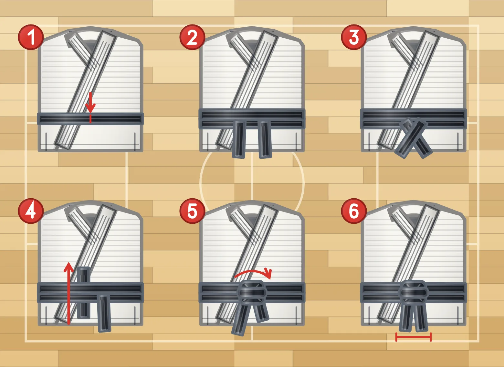

# 柔道の帯の結び方、6 つの手順

[README に戻る](../README.md) · 日本語 · [English](obi-steps.md)

<picture>
<source media="(prefers-color-scheme: dark)" srcset="images/obi-steps-dark.webp">

</picture>

`gear:obi-step-1` から `gear:obi-step-6` までの 6 つのエンブレムは、柔道衣の帯の標準的な結び方を順に示します。どれも [`gear:judogi`](japanese-sports.md#the-judo-suit) の上衣を大きく描き、帯をその手順の形にしたものです。角の赤い数字が手順の番号で、赤い小さな印が見てほしいところ（帯の真ん中、端の通り道、両端の長さのそろい）を示します。

| 手順 | id | 描かれているもの | 英語の説明 |
| --- | --- | --- | --- |
| 1 | `gear:obi-step-1` | 帯の真ん中を、柔道衣の上からおなかの中心に当てる。真ん中に切り込みの印がある。 | Centre the belt on the belly |
| 2 | `gear:obi-step-2` | 帯を腰に二重に巻き、背中で交差させた両端を前に戻す。おなかに二重の帯、前に垂れた 2 本の端。 | Wrap it twice round the waist |
| 3 | `gear:obi-step-3` | おなかの前で両端を交差させる。着る人の左の端（絵では右側）が上。 | Cross the ends in front |
| 4 | `gear:obi-step-4` | 片方の端を、二重に巻いた帯の下から上へ通す。端は帯の下に見え、帯の上にも出る。赤い矢印が通り道を示す。 | Tuck one end up under both layers |
| 5 | `gear:obi-step-5` | 本結びで結ぶ。左を右の上に重ね、次に右を左の上に重ねる。結び目はできたが、両端の長さはまだそろっていない。 | Tie the flat square knot |
| 6 | `gear:obi-step-6` | 結び目を締め、両端を同じ長さにして垂らす。先端の下の印が長さのそろいを示す。 | Both ends hanging even |

上衣は、ふつうの柔道衣と同じく右前に合わせます。右の身頃を先に体に当て、その上に左の身頃を重ねる着方で、着る人の左の身頃が上になります。絵では右側の身頃が上で、襟は絵の右側の首元から左下へ走ります。逆の左前は死装束の着方です。絵は `gear:judogi` と同じもので、手順の絵と柔道衣が食い違わないことは、テストで確かめています。帯が小さな表示でも読めるよう、ズボンと袖は描かず、上衣だけを大きく描いています。

## `step` オプションではなく 6 つの id

このパッケージでは、色以外が違う絵は別の id にしているので、手順も 6 つの id にしました。白と青の柔道衣、正面と背面、各段位の帯はそれぞれ別の id で、オプション（`tint`、`accent`、`backnumber`）は色を変えるか、絵に何かを書き込むだけです。手順ごとに描かれるものが変わるため、id にしています。そのおかげで、手順ごとに `EMBLEM_IDS`、`GEAR_IDS`、`JAPANESE_IDS` に入り、日本語と英語の名前と説明、回転、バンドラー用の独立したモジュールを持ちます。手順を並べた教材も、id の一覧だけで表せます。

短く書きたいときは `obiStep(step, options)` を使います。帯の `obi(rank, options)` と同じ考え方です。オプションはふつうに使えます。`tint` が上衣の色、`accent` が帯の色（初期設定は黒）です。番号と赤い印は柔道衣の一部ではないので、色は変わりません。

```js
import { emblemName, obiStep, renderEmblem } from "@johnmorrisdotca/dougu-sports";

const steps = [1, 2, 3, 4, 5, 6].map((n) => `gear:obi-step-${n}`);
console.log(steps.length); // 6
console.log(emblemName(steps[4], "ja")); // 帯の結び方（5）本結び
console.log(emblemName(steps[4])); // Belt step 5: square knot
console.log(obiStep(6, { accent: "#7a4a24" }).includes("#7a4a24")); // true
console.log(renderEmblem("gear:obi-step-3", { tint: "#1456b6" }).includes("#1456b6")); // true
```

どの手順も、ほかの柔道衣と同じように回転し、どの角度でも枠からはみ出しません。結ぶ順序は、作者が参考にした手順図に従っています（[参考資料](references.md#judo-and-karate-suits-and-belts)）。IJF の規則が求めるのは、結び目が「正しくしっかり結ばれている」ことと、帯の先が結び目から 20〜30 cm であることだけです。
