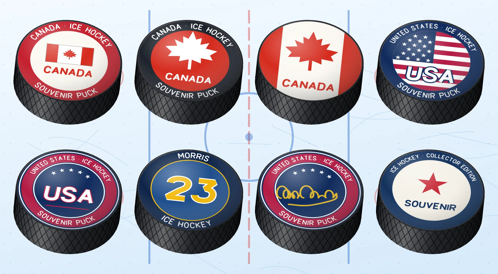

# Printed pucks

[Back to the README](../README.md) · [日本語](pucks.ja.md) · English

<picture>
<source media="(prefers-color-scheme: dark)" srcset="images/pucks-dark.webp">

</picture>

A hockey puck is black vulcanised rubber with a printed top face, and the souvenir ones are the most printed objects in the sport: a flag, a name, a number, a signature. The package draws eight of them, all in true 3D, all turning with `emblemFrame` and `ballFrame`. Each is the same puck as `ball:puck` (76.2 mm across, 25.4 mm thick, one to three, the ridged grip on its edge) with a print laid on its top face by the puck's own rotation: the print foreshortens as the top tips toward you, turns with the puck, and is gone when the top is turned away (the bottom is plain rubber). The grip shows on the rim as it turns.

Everything on the face is our own drawing: our own maple leaf, our own flags, our own wide lettering (a stroke alphabet in `src/emblems/ball/ball.letters.ts`, no font file), a made-up name and number, and a made-up signature. No team's or league's logo, wordmark or maker's mark is used, and the words on the rings are plain descriptions (`CANADA · ICE HOCKEY`, `SOUVENIR PUCK`).

## The ids

| Id | What is printed |
| --- | --- |
| `puck:canada` | Our flag of the Canadian pattern (red, white, red, with the leaf) with CANADA under it in wide letters, on a white face inside a red ring of words |
| `puck:canada-red` | A red face with a big white maple leaf and CANADA under it, inside a dark ring of words |
| `puck:canada-white` | A white face with the flag's red bands left and right, a big red leaf and CANADA under it |
| `puck:usa` | A disc of stars and stripes with USA lettered across it, inside a navy ring of words |
| `puck:usa-navy` | A navy face, a red ring between white hairlines, five stars and USA in big white letters |
| `puck:player` | Like a jersey: a made-up surname on the ring (`MORRIS`), a big number (`23`), a gold ring |
| `puck:signed` | The navy puck with a made-up gold marker signature across it |
| `puck:souvenir` | A generic one: a cream face, a navy ring of words you choose, a star or your own picture, and words under it |

The pucks are in one module, `@johnmorrisdotca/dougu-sports/ball/ball.puck.print`, and in the main entry as `PUCK_CANADA`, `PUCK_CANADA_RED`, `PUCK_CANADA_WHITE`, `PUCK_USA`, `PUCK_USA_NAVY`, `PUCK_PLAYER`, `PUCK_SIGNED` and `PUCK_SOUVENIR`. `PUCK_IDS` lists the ids, and `isBallId`, `ballFrame` and `lineup` take them like any ball.

```js
import { PUCK_IDS, renderEmblem } from "@johnmorrisdotca/dougu-sports/emblems";
import { emblemFrame } from "@johnmorrisdotca/dougu-sports/turn";

console.log(PUCK_IDS.length); // 8
console.log(renderEmblem("puck:canada", { size: 128 }).includes("<title>Canada flag puck</title>")); // true
// Turned until its top faces away, the puck is plain rubber: the print is gone.
console.log(emblemFrame("puck:usa", { pitch: -80 }).includes("matrix(")); // false
console.log(emblemFrame("puck:usa", { pitch: 10 }).includes("matrix(")); // true
```

## The `face` option

Any puck takes `face`, which replaces any part of the print it starts with. `ball:puck`, given a face, is drawn as `puck:souvenir` with it (the plain puck stays plain without one).

| Field | What it does |
| --- | --- |
| `design` | The design to start from: `canada`, `canada-red`, `canada-white`, `usa`, `usa-navy`, `player` or `souvenir`. A puck has its own; this swaps it, so `puck:souvenir` can be any of them |
| `image` | Any SVG (a logo, a crest): made safe first (below), fitted into the middle, and put in the place of the design's own picture |
| `emblem` | The id of a dougu emblem (`"trophy:cup"`), drawn small in the middle. Resolved by `renderEmblem`, `emblemFrame` and `ballFrame`; a puck module imported alone takes `image` |
| `flag` | A country code. `"ca"` and `"us"` are drawn by this package; any other needs the `flags` option of the call (below) |
| `text` | The words under the picture (`"CANADA"`): one line, 24 characters |
| `ringText` | The words round the edge: a string (the top), a pair `[top, bottom]`, or `false` for no ring. 32 characters a line |
| `number` | A big number, like a jersey's: up to three letters or digits |
| `name` | A surname, set on the ring: 14 characters |
| `signature` | A seed for a made-up signature (a number or any text), or `false` for none |
| `colors` | By name, `{ field, ring, ink, accent, signature }`, or an array in that order. A colour is `#rgb`, `#rrggbb` or `rgb()`; anything else is ignored |

`flags` is not a field of `face` but an option of the call, beside `face`, `size` and the rest, and it is the renderer taisen-brackets takes too, so one adapter over hata serves every package: `flags(code, { shape: "round" | "square" | "rect", size, theme: "inherit" | "light" | "dark" }) => string | null | undefined`. It is synchronous (a drawing is a pure function of its options, and hata's `flag()` is asynchronous, so load the flags first and pass `(code) => loaded[code]`). The puck asks for a `"rect"` flag at 120 pixels, with the `theme` of the call (`light` and `dark` as given, `inherit` for `auto` and `inherit`); its SVG is made safe like `image`, and `null` or `undefined` for a code it has no flag for leaves the built-in flag (or none). It wins over the built-in `"ca"` and `"us"`.

```js
import { renderEmblem } from "@johnmorrisdotca/dougu-sports/emblems";

// Your own picture: here a red maple leaf drawn for the example, in a box of 100 by 100.
const logo = '<svg viewBox="0 0 100 100"><path d="M50 5L56.8 23L66.2 18.5L64.8 33.8L80.2 27.5L74.8 41L95 44.6L83.3 55.4L88.7 66.2L68 63.5L68.9 75.2L52.7 68.9L52.7 91.4L47.3 91.4L47.3 68.9L31.1 75.2L32 63.5L11.3 66.2L16.7 55.4L5 44.6L25.2 41L19.8 27.5L35.1 33.8L33.8 18.5L43.2 23Z" fill="#d52b1e"/></svg>';
const own = renderEmblem("puck:souvenir", { face: { image: logo, text: "CANADA", ringText: ["CANADA · ICE HOCKEY", "SOUVENIR"], colors: ["#f4f1e8", "#7a1f18"] } });
console.log(own.includes("#d52b1e")); // true

// A country the package does not draw comes from the caller's own renderer, the `flags` option of the call.
const flags = () => '<svg viewBox="0 0 4 3"><rect width="4" height="3" fill="#fff"/><circle cx="2" cy="1.5" r=".9" fill="#bc002d"/></svg>';
const japan = renderEmblem("puck:souvenir", { flags, face: { flag: "jp", text: "JAPAN", ringText: ["NIPPON · ICE HOCKEY", "SOUVENIR"], colors: { ring: "#bc002d" } } });
console.log(japan.includes("#bc002d")); // true

// A player puck with a made-up name and number, and a signed one with a gold or black marker.
const player = renderEmblem("puck:player", { face: { name: "SMITH", number: 7 } });
const signed = renderEmblem("puck:canada-white", { face: { signature: "any seed", colors: { signature: "#111111" } } });
console.log(player.includes("matrix("), signed.includes("stroke-linecap")); // true true
```

## The signature

A signature is a squiggle drawn by a seeded pen (`src/emblems/ball/ball.signature.ts`): a first name and a surname, each a tall looped capital and a run of looped humps joined by one smooth curve, then a flourish underneath. The same seed always draws the same stroke, and no seed is anyone's real hand, so it reads as a signature and is nobody's. `signature: 7` is a number or any text (`"Ace"`); `false` or nothing draws none. The ink is `colors.signature`: gold on the dark pucks and black on the light ones by default.

## Lettering

The letters are strokes with no font: each glyph is a centre line in a box 90 units tall, adapted from the block letters of senshu-jerseys (the same author, the same licence), drawn here wide, heavy and leaning a little forward. A line of text is one path, so the print looks the same everywhere and is a few hundred bytes. On the ring the letters stand on an arc and read round it: outward on the top, inward on the bottom. A character with no glyph (a Japanese name, an emoji) is left out; the glyphs are the capitals A to Z (a small letter is its capital, an accented one its plain one), the digits, and `- . , ' / : & ·`.

## Safe images

An `image` or a flag from a renderer is SVG from outside, so it is taken apart and put back with a strict allow-list (`src/emblems/ball/ball.image.ts`): only shapes, groups, gradients and clip paths survive, with only the attributes a drawing needs and values that cannot carry an address, an entity or a script. Script, style, text, image, use, foreignObject, filters, links and event handlers are dropped with what they hold, and `style="fill:red"` becomes `fill="red"`. Ids are renamed under the puck's own prefix, so two pucks in a page cannot reach each other's gradients. Text, names and colours are never put in the markup as they are: text becomes strokes, and a colour that is not a colour is ignored.

## What is left out

No printed puck carries the skater-and-leaf logo of a national hockey federation, a national association's shield, the wordmarks of a national team or a federation, a maker's mark, the name of a famous game, a real person's signature or a real player's name. The country names, the maple leaf and the flags are our own drawings, and the made-up name and number on `puck:player` are only an example.

## Looking at them

`node scripts/emblem-sheet.mjs sheet.png puck: --turn` draws a contact sheet of the pucks at 256, 64 and 16 pixels in light and dark, still and turned. The demo has a "Print a puck" section, and every puck is in the [gallery](https://johnmorrisdotca.github.io/dougu-sports/gallery.html).
